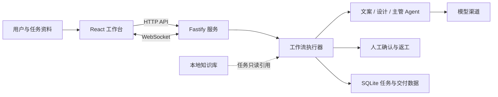

# AgentFlux-workbench

AgentFlux-workbench 是面向电商新品上架和小红书种草内容的多 Agent 协作工作台。它将任务资料、阶段产出、Agent 协作、人工决策和最终交付组织在同一条可追踪、可审核、可返工的工作流中。

项目采用前后端分离架构，包含 React 工作台、Fastify 服务、SQLite 数据层、共享工作流定义和可选的浏览器沙盒演示模式。

## 项目概览

工作台围绕内容生产任务组织角色分工与阶段交付。任务从需求输入开始，经过 Agent 生成和人工审核，再进入返工、复核或交付归档；每个阶段的状态、负责人和产出都能在工作台中查看。

## 核心价值

| 业务问题 | 工作台提供的能力 |
| --- | --- |
| 内容任务跨角色、跨工具，进度难以追踪 | 以任务和工作流阶段组织需求、产出、负责人及事件记录 |
| AI 内容需要人工判断，不能无审核地进入下一步 | 在关键阶段设置确认点，支持采纳、打回返工和主管回退 |
| 文案与视觉产出分阶段生成，版本容易混乱 | 按任务和产出类型保存交付物、版本及审核状态 |
| Agent 执行状态和协作过程不透明 | 通过实时事件更新任务、交付物、Agent 状态、审批和聊天消息 |
| 业务资料与生产流程容易互相绑定 | 知识库可供任务只读引用；知识库不可用时，工作流仍可独立运行 |

## 工作流

两条业务流程共享任务、Agent、事件和交付物基础能力，同时分别定义阶段、确认点与返工路径。

### 电商新品上架

`需求对接 → 卖点文案 → 主图设计 → 详情图设计 → 主管校对 → 交付完成`

- 文案、主图和详情图阶段设有人工作品确认点；主图与详情图支持按渠道组织图像子任务。
- 采纳产出后进入下一阶段；打回则回到对应阶段重新生成。
- 主管校对通过后归档交付；发现问题时，可以回退到文案、主图或详情图阶段。

### 小红书种草笔记

`选题策划 → 笔记撰写 → 首图设计 → 内页设计 → 主管校对 → 交付完成`

- 选题、笔记、首图和内页图分别设置确认点。
- 首图单独生成并确认后，再进入内页图阶段；内页图数量由任务配置决定。
- 主管校对和交付归档按工作流定义自动推进；发现问题时可回退到对应内容阶段。

## 核心能力

### 多 Agent 分工

工作站按业务角色展示文案、设计和主管等 Agent。工作流阶段声明负责人，执行器据阶段定义推进任务；Agent 可通过聊天参与协作，执行状态与任务事件同步展示。

### 人工审核与返工

确认点是工作流状态的一部分。用户可以查看阶段交付物并作出决定：采纳后按条件边推进，打回后沿返工边重新执行。主管校对支持将问题回退到相关阶段，保留任务事件和交付版本供追溯。

### 交付物与版本记录

任务可以关联文案、图片等交付物。工作台提供交付物版本、差异与来源记录，并支持交付包导出；审核状态与任务阶段一起呈现。

### 实时协作事件

后端通过 WebSocket 广播任务更新、事件记录、交付物变更、Agent 状态、审批提示和聊天消息。前端据此刷新协作视图，减少手动刷新造成的状态延迟。

### 知识库与任务资料

知识库支持资料浏览、检索与健康状态检查。新建任务时可以选择关联资料，工作流只读使用这些上下文；知识库索引与工作流状态分开管理。

## 系统结构



### 技术栈

| 层级 | 技术 | 用途 |
| --- | --- | --- |
| 前端 | React 19、TypeScript、Vite 6、Tailwind CSS v4 | 工作台界面、任务与协作视图 |
| 后端 | Node.js、Fastify 5、`@fastify/websocket` | HTTP API、实时事件与聊天消息 |
| 数据 | SQLite、Node.js `node:sqlite` | 任务、Agent、事件和交付数据 |
| 共享层 | pnpm workspace、`@workbench/shared` | 前后端共用类型、工作流定义与事件协议 |

## 目录结构

```text
backend/             Fastify API、工作流执行器、Agent、SQLite 与知识库服务
frontend/            React 工作台、页面功能、沙盒演示与静态资源
packages/shared/     前后端共享类型、事件协议和工作流定义
docs/示例Vault/      沙盒与默认技能使用的示例知识库数据
```

## 本地运行

### 环境要求

- Node.js 22 或更高版本
- pnpm 9 或更高版本

### 安装依赖

在仓库根目录运行：

```powershell
pnpm install --ignore-scripts
```

### 配置模型渠道（可选）

将 `backend/.env.local.example` 复制为 `backend/.env.local`，并按需配置本机模型渠道。`.env.local` 已被 Git 忽略；不要把真实 API Key 写进源码、README 或提交记录。

没有配置模型渠道时仍可启动应用并浏览工作流；需要真实模型生成时，再配置相应的文本、生图或视觉审核渠道。

### 启动后端

在一个终端中运行：

```powershell
Set-Location backend
.\node_modules\.bin\tsx.cmd watch src/index.ts
```

后端默认监听 `http://127.0.0.1:4311`。

### 启动前端

在另一个终端中运行：

```powershell
Set-Location frontend
.\node_modules\.bin\vite.cmd
```

打开 <http://127.0.0.1:4310>。

## 浏览器沙盒

在前端地址后添加 `?sandbox=1`，例如：

```text
http://127.0.0.1:4310/?sandbox=1
```

沙盒在浏览器中使用预置演示数据，不连接真实后端；会改变业务状态的部分操作处于冻结状态。演示数据保存在当前页面内存中，刷新后恢复初始状态。普通地址不带该参数时，前端连接本地 Fastify 后端。

## 检查命令

```powershell
pnpm typecheck
pnpm test
```

## 运行与部署说明

本仓库提供完整前后端源码。在线运行完整工作台需要分别部署前端、Node.js 后端及持久化存储，并为后端配置运行所需的模型渠道。GitHub Pages 只能托管静态文件，不能单独运行本项目的 Fastify 服务与 SQLite 数据层。
